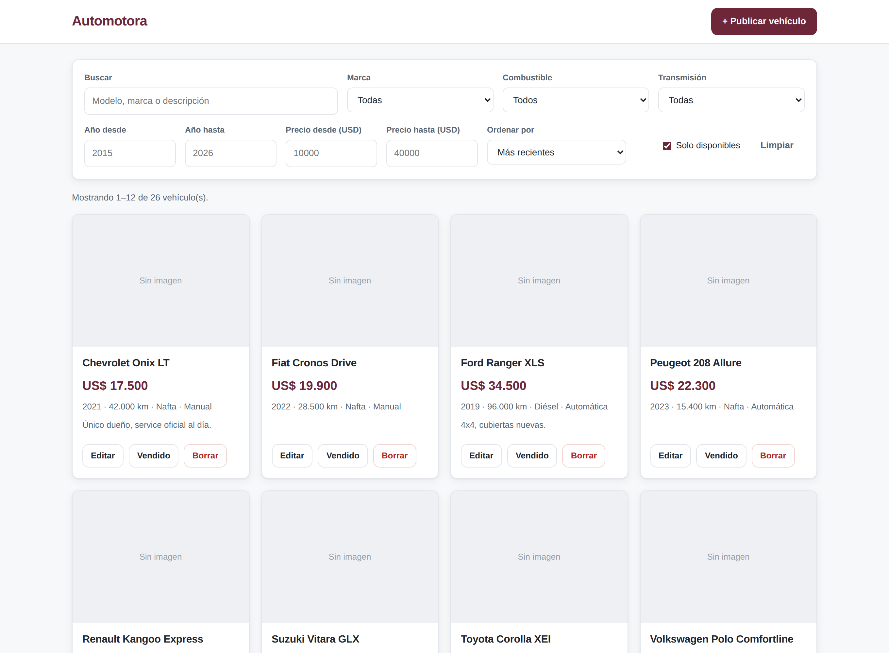
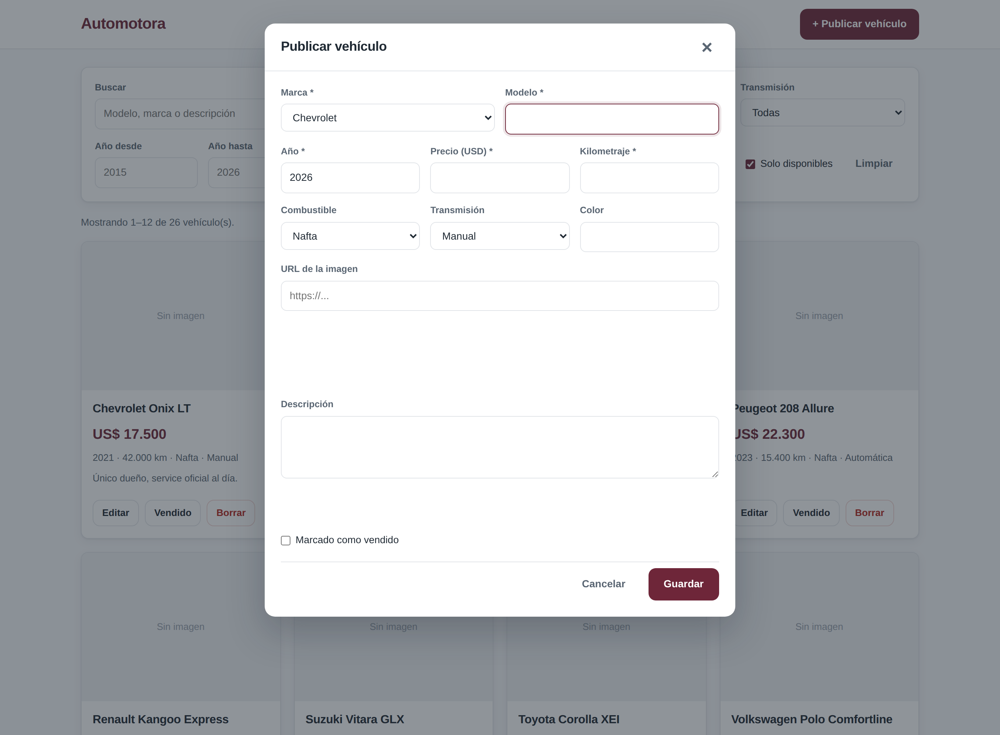

# Automotora — API de gestión de vehículos

Aplicación full stack para la publicación y búsqueda de vehículos de una automotora.
Backend REST en **C# / ASP.NET Core 8** con **Entity Framework Core** sobre **SQL Server**,
y una interfaz web en **HTML, CSS y JavaScript** sin frameworks que consume esa API.

Autor: **Facundo Robaño** — [LinkedIn](https://www.linkedin.com/in/facundo-roba%C3%B1o-1b584221b/) · [GitHub](https://github.com/Facundo-RC)

---

## Qué resuelve

Una automotora necesita publicar su stock, mantenerlo actualizado y que un cliente pueda
encontrar rápido lo que busca. La aplicación cubre el ciclo completo: alta del vehículo,
búsqueda con filtros combinados, edición, marcado como vendido —sin perder el historial— y baja.

## Demo

**[Ver la demo](https://facundo-rc.github.io/automotora/)**

GitHub Pages sirve solamente archivos estáticos, así que ahí no hay backend en C#
detrás de la interfaz. Para que la demo igual se pueda recorrer entera, el front
detecta que la API no responde y pasa a **modo demostración**: carga
`datos-demo.json` y resuelve todo en memoria —filtros, orden, paginado, alta, edición,
baja y marcado como vendido— reproduciendo las mismas reglas que el backend, incluidas
las validaciones y el control de duplicados. Un cartel lo aclara arriba de todo, y los
cambios se pierden al recargar.

Con la API levantada en local, ese modo no se activa nunca: `js/api.js` sólo cae al
respaldo cuando la respuesta no viene de la API.

## Capturas

| Catálogo | Formulario de alta |
|---|---|
|  |  |

La interfaz es responsiva: en pantallas chicas los filtros se apilan y la grilla pasa a una columna
([captura](docs/captura-mobile.png)).

## Stack

| Capa | Tecnología |
|---|---|
| Backend | C# 12, ASP.NET Core 8 (Web API) |
| Acceso a datos | Entity Framework Core 8 (code first + migraciones) |
| Base de datos | SQL Server (LocalDB o Express) |
| Frontend | HTML5, CSS3 y JavaScript ES6+ (sin frameworks) |
| Documentación | Swagger / OpenAPI |
| Pruebas | Colección de Postman con tests automáticos |

## Estructura

```
Automotora/
├── src/Automotora.API/
│   ├── Controllers/      Endpoints HTTP. No contienen lógica de negocio.
│   ├── Services/         Reglas de negocio y acceso a datos.
│   ├── Data/             DbContext, configuración del modelo y datos de ejemplo.
│   ├── Models/           Entidades que se mapean a tablas.
│   ├── DTOs/             Lo que entra y sale por la API.
│   ├── Middleware/       Manejo centralizado de errores.
│   ├── Migrations/       Migración inicial de EF Core.
│   └── wwwroot/          Interfaz web (HTML, CSS, JS) + datos del modo demo.
├── docs/
│   └── casos-de-prueba.md    Plan de pruebas QA.
└── postman/
    └── Automotora.postman_collection.json
```

**Decisión de diseño:** los controllers no conocen el `DbContext`. Reciben la petición,
delegan en un service a través de una interfaz y devuelven el resultado. Eso deja la lógica
en un solo lugar y permite cambiar el acceso a datos o testear los services sin levantar la API.

## Cómo levantarlo

**Requisitos:** [.NET 8 SDK](https://dotnet.microsoft.com/download/dotnet/8.0) y SQL Server.
Si tenés Visual Studio, LocalDB ya viene instalado; si no, alcanza con SQL Server Express.

```bash
git clone https://github.com/Facundo-RC/automotora.git
cd automotora

dotnet run --project src/Automotora.API
```

Eso alcanza. La migración inicial viene en el repositorio, así que al arrancar la
aplicación crea la base, aplica el esquema y carga los datos de ejemplo sola.

- Interfaz web: `http://localhost:5186`
- Documentación de la API: `http://localhost:5186/swagger`

Se cargan 8 marcas y 10 vehículos de ejemplo. Si tu SQL Server no es LocalDB, cambiá la
cadena `ConnectionStrings:Automotora` en `src/Automotora.API/appsettings.json`.

## Endpoints

| Método | Ruta | Descripción |
|---|---|---|
| `GET` | `/api/vehiculos` | Lista con filtros, orden y paginado |
| `GET` | `/api/vehiculos/{id}` | Detalle de un vehículo |
| `POST` | `/api/vehiculos` | Publica un vehículo |
| `PUT` | `/api/vehiculos/{id}` | Actualiza todos los datos |
| `PATCH` | `/api/vehiculos/{id}/estado-venta` | Marca como vendido o lo reactiva |
| `DELETE` | `/api/vehiculos/{id}` | Elimina el vehículo |
| `GET` | `/api/marcas` | Marcas con su cantidad de vehículos |
| `POST` | `/api/marcas` | Crea una marca |
| `DELETE` | `/api/marcas/{id}` | Elimina una marca sin vehículos asociados |

**Parámetros del listado:** `texto`, `marcaId`, `anioMin`, `anioMax`, `precioMin`, `precioMax`,
`combustible`, `transmision`, `vendido`, `ordenarPor`, `pagina`, `tamanoPagina`.

Ejemplo:

```
GET /api/vehiculos?marcaId=7&anioMin=2020&precioMax=35000&ordenarPor=precio&pagina=1&tamanoPagina=12
```

Respuesta:

```json
{
  "items": [
    {
      "id": 7,
      "marcaId": 7,
      "marca": "Toyota",
      "modelo": "Corolla XEI",
      "anio": 2022,
      "precio": 31500.00,
      "kilometraje": 34000,
      "combustible": "Hibrido",
      "transmision": "Automatica",
      "color": "Plata",
      "vendido": false
    }
  ],
  "pagina": 1,
  "tamanoPagina": 12,
  "totalItems": 1,
  "totalPaginas": 1,
  "hayPaginaSiguiente": false,
  "hayPaginaAnterior": false
}
```

## Manejo de errores

Toda la API responde los errores con el mismo formato, sin exponer detalle interno:

```json
{
  "mensaje": "Hay errores de validación en los datos enviados.",
  "errores": {
    "Anio": ["El año debe estar entre 1900 y 2100."]
  }
}
```

| Código | Cuándo |
|---|---|
| `400` | Datos inválidos o regla de negocio incumplida |
| `404` | El recurso no existe |
| `500` | Error inesperado (se registra en el log, no se muestra al cliente) |

## Pruebas

El proyecto incluye un plan de pruebas con **48 casos** documentados en
[`docs/casos-de-prueba.md`](docs/casos-de-prueba.md): funcionales, de validación,
de valores límite y de reglas de negocio.

La colección de Postman (`postman/`) automatiza 13 de esos casos con aserciones sobre
código de estado, contrato de respuesta y tiempo de respuesta.

```bash
# Importar la colección en Postman, o correrla desde la terminal:
newman run postman/Automotora.postman_collection.json --env-var baseUrl=http://localhost:5186
```

## Decisiones técnicas

- **DTOs separados de las entidades.** La API nunca expone la entidad de base directamente:
  evita filtrar campos internos y desacopla el contrato del esquema.
- **Paginado obligatorio con tope de 50.** Sin tope, un cliente puede pedir toda la tabla
  en una sola llamada y voltear el servidor.
- **Borrado restringido de marcas.** Eliminar una marca con vehículos asociados devuelve un
  error explicativo en lugar de arrastrarlos por cascada.
- **Baja lógica de la venta.** Un vehículo vendido se marca, no se borra: se conserva el historial.
- **`AsNoTracking` en las consultas de lectura.** EF no necesita seguir entidades que no se van
  a modificar; en listados es una diferencia real de rendimiento.
- **Índices sobre marca, año y precio**, que son los campos por los que más se filtra.
- **Escapado de HTML en el front.** Todo texto que viene de la API se escapa antes de insertarse
  en el DOM, para no abrir la puerta a XSS.

## Pendientes

- [ ] Autenticación con JWT: hoy cualquiera puede publicar o borrar.
- [ ] Pruebas automatizadas con xUnit sobre la capa de servicios.
- [ ] Carga de imágenes al servidor en vez de guardar una URL externa.
- [ ] Despliegue en Azure App Service con Azure SQL.
